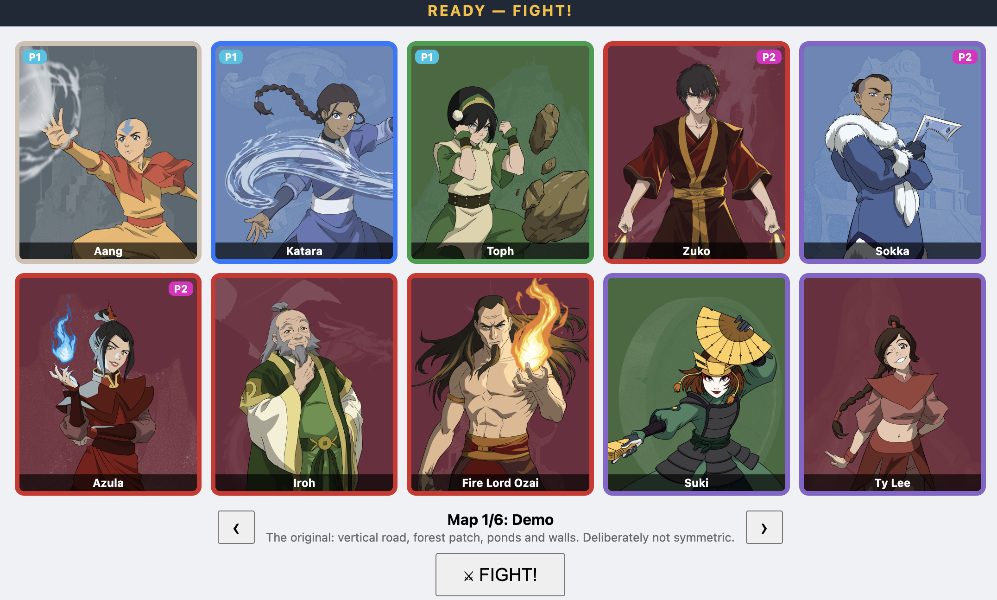

# Avatar Tactical Card Game

<p align="center">
  
</p>

> **Unofficial fan project.** A non-commercial prototype made by fans, for learning
> and playtesting only. Not affiliated with or endorsed by Nickelodeon, Avatar
> Studios, or any rights holders. All code, rules text, and game design here are
> original; do not use this project commercially.

A deterministic **3v3 tactical card-game prototype** set in the Avatar universe
(ATLA + LOK). Draft three fighters, chain bending techniques from a shared deck,
and knock out the enemy team on a hand-editable 7×7 board. Hot-seat, local-only,
no backend.

Player-facing rules: [`docs/rules.md`](docs/rules.md). Engine, roster, card, and
balance specs: [`specs/`](specs/). Development history and open work:
[`docs/progress.md`](docs/progress.md).

## Quick start

```sh
make install
make dev        # UI prototype
make test       # deterministic rules tests
make typecheck
make build
```

Or with npm: `npm install`, `npm run dev`, `npm test`, `npm run typecheck`,
`npm run build`. Run `make help` for all targets.

The landing page has Game and Card roster tabs while the temporary `ADMIN_MODE`
switch in `src/App.tsx` is enabled.

## What's in the box

- **20 fighters + 4 companions** across Water / Earth / Fire / Air / Non-bending,
  drawn from ATLA and LOK. Appa, Momo, Naga, and Pabu are companions, not
  fighters.
- **21 cards** — starter techniques, signature gear, universal defenders, and
  the water-locked Healing Waters. Card faces are 5:7 and print their full rules
  text verbatim; hidden assignments show card backs to the opponent.
- **30-round matches.** Win by knocking out the whole enemy team; reaching round
  30 is a draw. Avatar State (Aang and Korra) adds Resonance buildup, a temporary
  damage/shield bonus, and an instant-loss risk while transformed.
- **Deterministic engine.** `applyGameAction(state, action)` is authoritative;
  the UI never mutates game state. Matches are seeded and replayable.
- **Track A utility AI** opponent by default, plus an optional local-LLM stance
  advisor (Track B) that can nudge weights but never act directly.

## Project layout

- `src/game/` — authoritative engine: `types.ts`, `state.ts`, `rules/`,
  `content/` (data single source), `maps/` + `mapGrid.ts`, and `ai/` + `auto.ts`.
- `src/App.tsx` + `src/ui/` — hot-seat UI: board, character sheets, hands, battle
  log, legend, combat FX, and shared animation timing.
- `src/theme.css` — every themed colour as a CSS variable.

## Editing the board

The demo board is `src/game/maps/demo.grid.txt`: seven rows of seven tiles split
by `|` (lines beginning with `#` are comments). Letters: `G` grass, `R` road,
`P` pond (blocks movement, not sight), `K` rocks, `F` forest, `W` wall (blocks
movement and sight), `I` ice, `B` blaze (created by fire in play), `A` ash. Full
names and engine ids also work. Parser tests: `src/game/mapGrid.test.ts`.

## Optional: LLM NPC advisor (Track B)

Off by default. To let a local model pick a per-round stance:

```sh
VITE_AI_LLM=1 npm run dev
VITE_AI_LLM=1 VITE_LLM_MODEL=qwen3.5:0.8b npm run dev   # custom Ollama model
```

Defaults to Ollama at `http://localhost:11434`. Server-side smoke test:
`make llm-live`. See `specs/npc_ai_plan.md` §3 for design and verified models.

## Tech stack

Vite + React + TypeScript (strict), Vitest, and plain CSS with a central variable
palette. No backend, component framework, canvas library, or animation timing
outside the shared duration constants.
