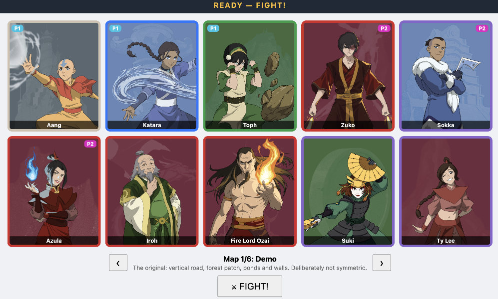

# Avatar Tactical Card Game — Prototype (MVP v0.3)

<p align="center">
  
</p>

> **Unofficial fan project.** This is a non-commercial prototype made by fans, for
> learning and playtesting only. It is not affiliated with, endorsed by, or connected
> to Nickelodeon, Avatar Studios, or any rights holders. All code, rules text, and
> game design here are original. Please do not use this project commercially.

A lightweight 3v3 tactical card-game prototype inspired by the Avatar universe
(ATLA + LOK). The goal is a playable, deterministic rules engine with a themed,
data-driven board — mechanics first, now with tile art and a central palette.

Player-facing rules live in `docs/rules.md`; engine and card design specs live in `specs/`.

## Tech stack

- **Vite + React + TypeScript (strict)** — minimal browser prototype
- **Vitest** (`npm test` / `make test`) — deterministic rules tests, no animation timing
- **Plain CSS** — a central variable palette (`src/theme.css`); board art is
  data-driven from `public/tiles/` (no component framework or canvas library)
- **No backend** — local hot-seat play; a single authoritative engine exposes
  `applyGameAction(state, action)` and the UI never mutates game state directly

## Layout

- `src/game/types.ts` — data shapes only (7×7 grid model + v0.3 economy)
- `src/game/state.ts` — match init, deployment validation, seeded decks, occupancy helpers
- `src/game/rules/` — grid, movement, damage, statuses, terrain, cards, turns, avatar, economy
- `src/game/content/` — characters, cards, terrain, economy tuning (single source of truth)
- `src/game/maps/demo.grid.txt` + `src/game/mapGrid.ts` — hand-editable 7×7 board and its parser
- `src/App.tsx` + `src/ui/` — hot-seat UI: grid board, character sheets with card slots, hands with assign/scrap, activation panel, battle log, icon legend
- `src/ui/animationTiming.ts` — single source of truth for combat-animation durations (injected as CSS variables)
- `src/ui/attackFx.ts` + `src/ui/combatText.ts` — element→attack-FX mapping and floating damage/heal numbers
- `src/ui/terrainTiles.ts` — terrain → tile art, label, rules blurb (drives the board and legend)
- `src/theme.css` — every themed colour, as CSS variables

## Run

With Make:

```sh
make install
make dev        # UI prototype
make test       # rules tests
make typecheck
make build
```

Or directly with npm (`npm install`, `npm run dev`, `npm test`, `npm run typecheck`, `npm run build`).
Run `make help` for all targets.

## Editing the board

The demo board is hand-editable text at `src/game/maps/demo.grid.txt`: seven rows
of seven tiles, one letter per tile, cells split by `|` (lines starting with `#`
are comments). Letters: `G` grass, `R` road, `P` pond, `K` rocks, `F` forest,
`W` wall, `I` ice, `B` blaze, `A` ash — full names and engine ids also work.
`src/game/mapGrid.ts` parses it (tests: `src/game/mapGrid.test.ts`). A `P` pond
blocks movement (you cannot enter, cross, or be pushed onto it) but not line of
sight; a `W` wall blocks both. Blaze is never placed by hand; it only appears in
play when fire ignites woodland.

## Roster

A 30-character fan pool across five classes (Water / Earth / Fire / Air / Non-bending),
drawing on characters from both animated series, with series/role/class metadata for
alignment restrictions. The demo drafts 10 fighters (core six + Iroh, Ozai, Suki,
Ty Lee); Appa and Momo are flagged companions, not fighters. Aang is currently
the only Avatar State–capable character; Resonance buildup, activation cost,
duration, and the active-Avatar instant-loss rule live in the shared engine, not in card data.

## Cards (21)

12 starter techniques + 2 signature gear (Glider, Boomerang) + Comet Strike bomb +
6 defender cards: **Travel Rations** (food = heal-over-time), **Miraculous Balm**
(instant spike heal 4, costs chi), **Second Wind** (instant self-heal 2 + Focus),
**Smoke Bomb** (shield + Focus), **Dust Toss** (chip + Exposed) — all universal —
plus the water-locked **Healing Waters** (instant heal 3). Every character
fits at least 6 cards; the hand list shows each card's requirement and who fits.

## Card presentation

Every card face is **5:7** (matching the card-back art `public/card_back.png`, 300×420)
and prints its full `rulesText` **verbatim** — never truncated or replaced with
icons. The hot-seat sheets flank each character with two card slots: a **gear** slot
and an **ability** slot. A face-down assignment is shown as the card face to its
owner and as the card back to the opponent; both sides' sheet columns share the
space either side of the board, and the acting player's hand sits under their own
sheets.

Combat feedback is CSS-only: each attack type (fire/water/air/earth/slash) plays a
short burst on every affected tile, and affected characters show a floating red
`-x` (or green `+y` heal). Both are drawn in a board-level overlay (`.fx-overlay`)
that mirrors the tile grid, so effects can spill across cell borders instead of
being clipped by a tile. All durations live in `src/ui/animationTiming.ts` and are
injected as CSS custom properties, so the keyframes and the JS dismissal timers
stay in sync.

## Roadmap (grid model + v0.3 economy)

1. ✅ Types + state (grid coords, deployment, occupancy)
2. ✅ Pure geometry (bounds, Manhattan, LOS, paths, AoE shapes)
3. ✅ Movement + terrain (normal moves, Evade, push/pull/swap, entry/expiry)
4. ✅ Card resolution (focused/tile/directional/AoE, reactions, statuses)
5. ✅ Round loop + victory + Avatar State (resonance, activation, risk)
6. ✅ v0.3 economy (chi bank, draw/assign/scrap, restrictions, slots, gear)
7. ✅ Starter content (core six + 18 complete cards) + playable hot-seat UI (versus draft, pucks, sheets, playing cards, legend, fits, e2e)
8. ✅ Demo tooling (Auto P1/P2 test toggles, UI smoke test, auto-vs-auto match sim)
9. ✅ Demo visuals (painterly terrain tiles + connected roads, redesigned pucks, terrain legend, CSS-variable theme)
10. ✅ Combat feedback (per-element attack FX — fire/water/air/earth/slash — and floating damage/heal numbers, drawn in a board overlay so they aren't clipped by tiles)
11. ✅ Card presentation (5:7 faces with verbatim rules text, sheet gear/ability card slots with hidden-info card backs, balanced P1/P2 columns, hand under the owner's sheets)
12. ✅ NPC opponent (Track A utility AI — `src/game/ai/`, no deps; `src/game/auto.ts`)
13. ⬜ End-to-end polish (passives, roster waves)
14. ⬜ Balance pass — lethality first (no KO finishes; every match hits the round cap). See `specs/balance_testing_plan.md` §10 for the baseline and the prioritized next steps; re-run `SWEEP_N=100 npx vitest run src/game/ai/balanceSweep.test.ts` after each change.
